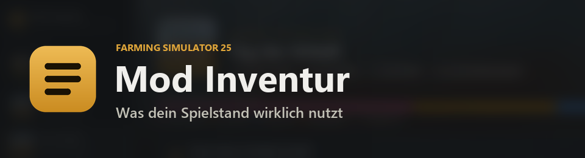
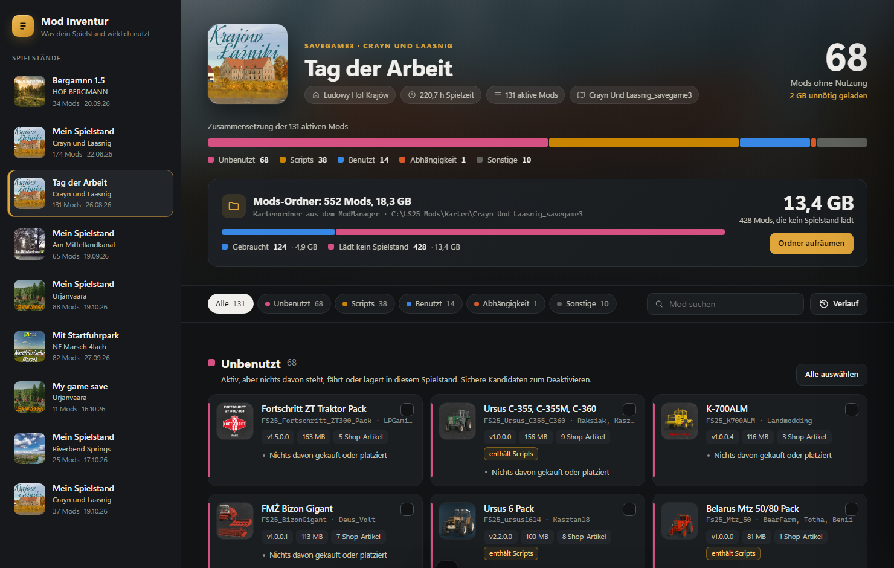
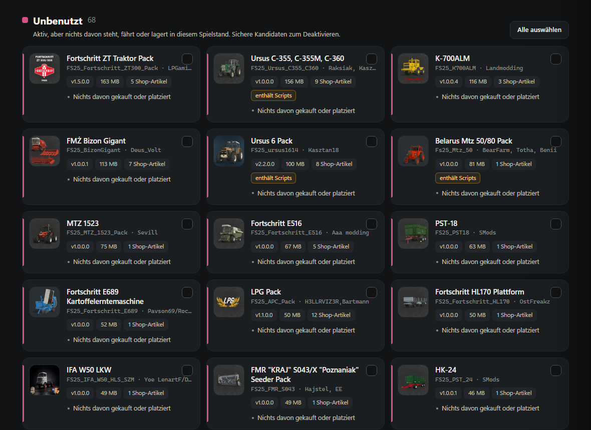

# FS25 Mod Inventory

**Was dein Spielstand wirklich nutzt.**

FS25 Mod Inventory ist ein kostenloses Windows-Programm für den Landwirtschafts-Simulator 25. Es schaut in einen Spielstand und zeigt, welche deiner aktiven Mods tatsächlich genutzt werden: platzierte Gebäude und Deko, gekaufte Fahrzeuge, Waren im Lager und alles, was davon abhängt. Den Rest schaltest du für diesen Spielstand mit einem Klick ab und nimmst ihn auf Wunsch aus dem Mods-Ordner, damit das Spiel ihn nicht mehr bei jedem Start einliest.

Der typische Fall: einen neuen Spielstand mit allen Mods anlegen, bauen und dekorieren, danach räumt FS25 Mod Inventory alles auf, was du nicht benutzt hast.

**Download:** [nalathan.itch.io/mod-inventur](https://nalathan.itch.io/mod-inventur)

English version: [README.md](README.md)

## Funktionen

* **Übersicht pro Spielstand:** Jeder aktive Mod landet in Benutzt, Abhängigkeit, Indirekt, Scripts oder Unbenutzt, mit einer Aufteilungsleiste und der Größe, die unnötig geladen wird.
* **Begründung auf jeder Karte:** Du siehst, warum ein Mod als benutzt gilt, zum Beispiel "3 in placeables.xml: hydrofornia, szopaOtwarta, szopaZamknieta".
* **Abhängigkeiten bleiben geschützt:** Alles, was die Karte, ein benutzter Mod oder ein aktives Script braucht, wird nie zum Entfernen angeboten.
* **Indirekte Nutzung:** Ein Produktions-Mod ohne platziertes Gebäude gilt trotzdem als benutzt, wenn einer seiner Fülltypen im Lager liegt.
* **Scripts entscheidest du:** Script-Mods platzieren nichts, ihre Nutzung lässt sich nicht messen. Sie stehen getrennt, mit einer Markierung, wenn sie eigene Daten im Spielstand haben.
* **Precision Farming ist immer gesperrt,** weil es Bodenkarten für jedes Feld führt.
* **Im Spielstand deaktivieren:** nimmt die gewählten Mods aus der Mod-Liste des Spielstands. Vorher wird ein Backup angelegt.
* **Mods-Ordner aufräumen:** Links werden gelöst, die Datei bleibt in deiner Bibliothek. Echte Dateien wandern in einen Archivordner. Gelöscht wird nie etwas. Teilen sich mehrere Spielstände einen Ordner, bleibt alles liegen, was einer davon aktiv hat.
* **Verlauf:** Ein Klick holt alles zurück, Mods wieder aktiv und Dateien wieder an ihrem Platz.
* **Warnungen** bei Objekten, die beim nächsten Speichern verloren gingen, und bei fehlenden Abhängigkeiten.
* **Erkennt den falschen Mods-Ordner:** Spielstände, die zu einem anderen Ordner gehören als dem im Spiel eingestellten, sind ausgegraut und lassen sich nicht ändern.
* **Deutsch, Englisch und Französisch,** passend zur Windows-Sprache.




## So geht's

1. Landwirtschafts-Simulator 25 beenden.
2. `FS25 Mod Inventory.exe` starten.
3. Links einen Spielstand wählen.
4. Die unbenutzten Mods auswählen, die raus sollen, oder "Alle auswählen".
5. Auf "Im Spielstand deaktivieren" klicken und wählen, ob die Dateien auch aus dem Mods-Ordner sollen.
6. Doch anders überlegt? Verlauf öffnen und "Zurückholen" klicken.

## Voraussetzungen

* Windows 10 oder 11
* Microsoft Edge (bei Windows vorinstalliert)
* .NET Framework 4.8 (bei Windows 10 und 11 vorinstalliert)

Keine Installation nötig, es ist eine einzelne exe.

## Selbst bauen

Alles Nötige ist bereits Teil von Windows, ein SDK braucht es nicht:

```
powershell -ExecutionPolicy Bypass -File build.ps1
```

Die exe landet in `dist\FS25 Mod Inventory.exe`.

## Gut zu wissen

* Das Spiel lädt immer ganze Mods. Ein einziges platziertes Objekt aus einem Pack hält das ganze Pack.
* Haufen eines Mod-Fülltyps, die auf dem Boden liegen, werden nicht erkannt.
* Manche Mods speichern globale Einstellungen, die andere Mods erwähnen. Ist so ein Mod abgeschaltet, schreibt das Spiel eventuell eine harmlose Warnung ins Log.
* Ohne den LS25 Mod Manager nutzt FS25 Mod Inventory den Mods-Ordner, der gerade im Spiel eingestellt ist.
* Als neues, unsigniertes Programm melden einige KI-basierte Virenscanner es eventuell.

## Datenschutz

Alles bleibt auf deinem PC. FS25 Mod Inventory zeigt sein Fenster über eine kleine Seite, die nur auf deinem eigenen Rechner läuft (127.0.0.1). Es verbindet sich nie mit dem Internet, es gibt kein Konto und kein Tracking. Verlauf, Icon-Zwischenspeicher und Log liegen in `%LOCALAPPDATA%\FS25 Mod Inventory`.

## Feedback

Fragen, Ideen oder ein Mod, der falsch einsortiert ist? Leg ein [Issue](https://github.com/Nalathan01/FS25-Mod-Inventory/issues) an oder schreib einen Kommentar auf der [itch.io-Seite](https://nalathan.itch.io/mod-inventur). Bei einem falsch einsortierten Mod helfen der Name des Mods und der Karte sehr.

## Links

* Download: https://nalathan.itch.io/mod-inventur
* Website: https://www.nalathan.de/
* YouTube: https://www.youtube.com/@nalathangaming
* Meine Mods im ModHub: https://www.farming-simulator.com/mods.php?title=fs2025&searchMod=Nalathan

## Code-Signatur

Kostenlose Code-Signatur durch [SignPath.io](https://about.signpath.io/), Zertifikat von der [SignPath Foundation](https://signpath.org/).

* Committer und Prüfer: [Nalathan01](https://github.com/Nalathan01)
* Freigabe: [Nalathan01](https://github.com/Nalathan01)

Signiert werden nur Builds, die GitHub Actions automatisch aus dem Quellcode in diesem Repository erstellt.

Datenschutz: Dieses Programm verbindet sich nicht mit dem Internet und schickt keine Informationen nach außen.

## Lizenz

MIT, siehe [LICENSE](LICENSE).

## Hinweis

FS25 Mod Inventory ist ein inoffizielles Fan-Tool. Es steht in keiner Verbindung zu GIANTS Software und wird von GIANTS Software nicht unterstützt. Farming Simulator ist eine Marke von GIANTS Software. Alle Mod-Namen und Icons gehören ihren Autoren.
