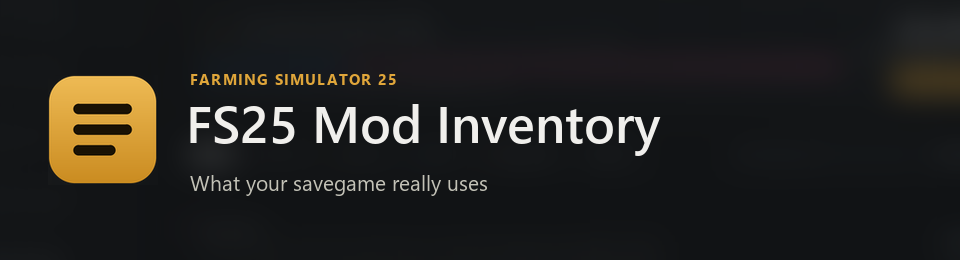
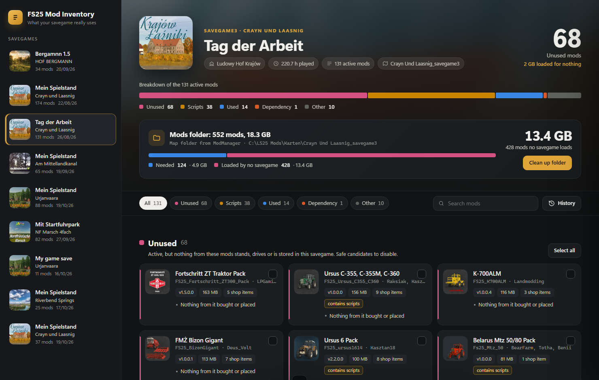
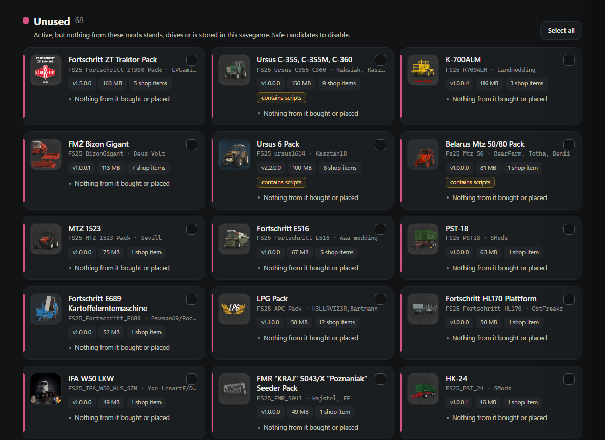

# FS25 Mod Inventory

**What your savegame really uses.**

FS25 Mod Inventory is a free Windows tool for Farming Simulator 25. It looks into a savegame and shows which of your active mods are actually in use: placed buildings and decorations, owned vehicles, goods in storage and everything they depend on. The rest can be switched off for that savegame with one click and taken out of the mods folder, so the game no longer reads it at every start.

The typical case: start a new savegame with all your mods active, build and decorate, then let FS25 Mod Inventory clean up whatever you didn't use.

**Download:** [nalathan.itch.io/mod-inventur](https://nalathan.itch.io/mod-inventur)

Deutsche Version: [README.de.md](README.de.md)

## Features

* **Per savegame overview:** every active mod is sorted into Used, Dependency, Indirect, Scripts and Unused, with a breakdown bar and the size that is loaded for nothing.
* **Reasons on every card:** you see why a mod counts as used, for example "3 in placeables.xml: hydrofornia, szopaOtwarta, szopaZamknieta".
* **Dependencies stay protected:** everything the map, a used mod or an active script needs is never offered for removal.
* **Indirect use:** a production mod with nothing placed still counts as used if one of its fill types is in storage.
* **Scripts are your call:** script mods place nothing, so their use can't be measured. They are listed separately, with a badge if they keep their own data in the savegame.
* **Precision Farming is always locked,** because it keeps soil maps for every field.
* **Disable in the savegame:** removes the selected mods from the savegame's mod list. A backup is made first.
* **Clean up the mods folder:** links are removed while the file stays in your library, real files are moved to an archive folder. Nothing is ever deleted. If several savegames share a folder, whatever any of them has active stays.
* **History:** one click brings everything back, mods active again and files back in place.
* **Warnings** for objects that would be lost on the next save and for missing dependencies.
* **Detects the wrong mods folder:** savegames that belong to a different folder than the one set in the game are greyed out and can't be changed.
* **English, German and French,** following your Windows language.




## How to use

1. Close Farming Simulator 25.
2. Start `FS25 Mod Inventory.exe`.
3. Pick a savegame on the left.
4. Select the unused mods you want to drop, or use "Select all".
5. Click "Disable in savegame" and choose whether the files should also leave the mods folder.
6. Changed your mind? Open the history and click "Restore".

## Requirements

* Windows 10 or 11
* Microsoft Edge (preinstalled on Windows)
* .NET Framework 4.8 (preinstalled on Windows 10 and 11)

No installation needed, it is a single exe.

## Build from source

Everything needed is already part of Windows, no SDK required:

```
powershell -ExecutionPolicy Bypass -File build.ps1
```

The exe is written to `dist\FS25 Mod Inventory.exe`.

## Good to know

* A mod is the smallest unit the game loads. One placed object from a pack keeps the whole pack.
* Heaps of a mod's fill type lying on the ground are not detected.
* Some mods keep global settings that mention other mods. If such a mod is switched off, the game may log a harmless warning.
* Without the LS25 Mod Manager, FS25 Mod Inventory uses the mods folder that is currently set in the game.
* As a new and unsigned program, a few AI based virus scanners may warn about it.

## Privacy

Everything stays on your PC. FS25 Mod Inventory shows its window through a small page served only to your own computer (127.0.0.1). It never connects to the internet, there is no account and no tracking. History, icon cache and log are stored in `%LOCALAPPDATA%\FS25 Mod Inventory`.

## Feedback

Questions, ideas or a mod that is sorted wrong? Open an [issue](https://github.com/Nalathan01/FS25-Mod-Inventory/issues) or leave a comment on the [itch.io page](https://nalathan.itch.io/mod-inventur). For a wrongly sorted mod, the name of the mod and of the map helps a lot.

## Links

* Download: https://nalathan.itch.io/mod-inventur
* Website: https://www.nalathan.de/
* YouTube: https://www.youtube.com/@nalathangaming
* My mods on the ModHub: https://www.farming-simulator.com/mods.php?title=fs2025&searchMod=Nalathan

## Code signing policy

Free code signing provided by [SignPath.io](https://about.signpath.io/), certificate by [SignPath Foundation](https://signpath.org/).

* Committers and reviewers: [Nalathan01](https://github.com/Nalathan01)
* Approvers: [Nalathan01](https://github.com/Nalathan01)

Only builds made automatically by GitHub Actions from the source code in this repository are signed.

Privacy: this program does not connect to the internet and does not send any information to networked systems.

## License

MIT, see [LICENSE](LICENSE).

## Disclaimer

FS25 Mod Inventory is an unofficial fan tool. It is not affiliated with or endorsed by GIANTS Software. Farming Simulator is a trademark of GIANTS Software. All mod names and icons belong to their authors.
